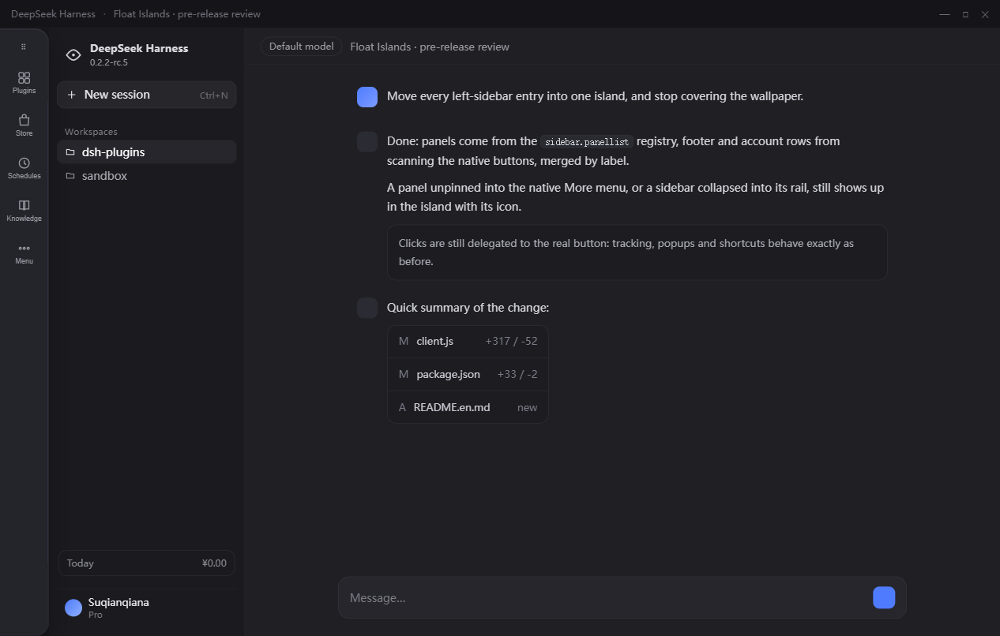
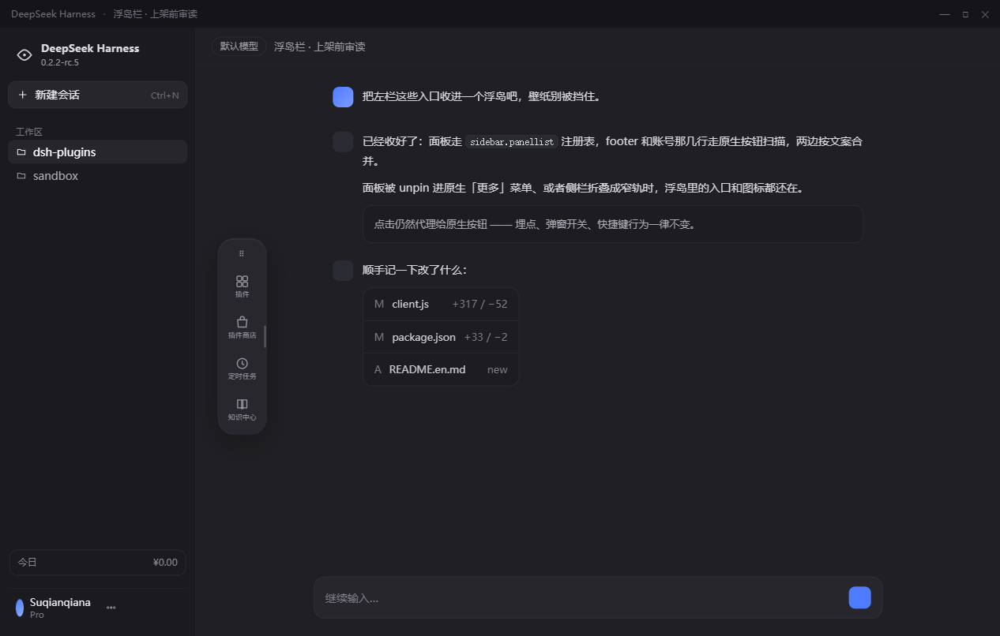

# Float Islands

Collect every left-sidebar entry of DeepSeek Harness into one draggable glass island. No entry is lost, no host event is moved, no wallpaper is covered.



<p align="center"><sub>Docked mode · native entries collapsed, the rail sits left of the sidebar</sub></p>



<p align="center"><sub>Floating mode · drag it anywhere, the glass shows the background through</sub></p>

- Targets: DSH 0.2.2-rc.5 and later, web client (desktop app and browser share the same UI)
- License: MIT
- Network: **no requests, no telemetry**

## Why

- A long sidebar eats vertical space: panels, knowledge base, workspaces, account and settings all stack in one column.
- With a wallpaper or skin, the sidebar is the biggest thing covering the picture.
- Every installed plugin adds another row; the island can lay them out in one row or collapse into a strip.

## Features

- 🏝 **Two shapes**: a draggable floating island, or a fixed rail docked left of the sidebar.
- 🧭 **Every entry**: panels come from the `sidebar.panellist` registry; footer actions, knowledge base, workspaces, account and settings come from a scan of the native buttons. A panel unpinned into the native "More" menu — or a sidebar collapsed into its rail — still appears in the island.
- 🖱 **Drag and resize**: drag the ⠿ grip to move; drag the right edge to go from 1 column to a single row.
- 🎨 **Wallpaper friendly**: translucent glass built from DSH theme tokens, with a lighter layer when a wallpaper engine or skin is detected. It never paints an opaque canvas.
- ⚙️ **Settings page**: entry migration, optional hiding of native entries, icon size, column count, side, position reset.
- 🌐 **English and Chinese**, following the DSH language.
- 🧩 **Host behaviour preserved**: clicks are delegated to the real button, so the host's tracking, popups and shortcuts keep working.

## Install

1. **Plugin manager** — install this package from the Plugins page, or add it to the profile bundles list.
2. **Command line** — `dsh --profile web plugin add link:<absolute path to this package>`.
3. **Market index** — add this URL under Settings → plugin market (Discover) → indexes, then install from the list:

   ```
   https://cdn.jsdelivr.net/gh/Suqianqiana/dsh-float-islands@main/market/index.json
   ```

> Editing `client.js` only needs a page refresh. Editing the `dsh.client` manifest in `package.json` needs a full DSH restart.

## Settings

| Setting | Default | Meaning |
| --- | --- | --- |
| Enable Float Islands | On | Off restores the native interface |
| Dock to the left rail | On | On is a fixed rail; off is a draggable island |
| Hide migrated native entries | **Off** on a fresh install | Opt-in: hides the ticked entries from the native sidebar |
| Frosted glass | On | Lighter glass layer while a wallpaper engine is active |
| Show entry names | On | Off shows icons only, names on hover |
| Side / edge offset | Left / 268 px | Where the island starts |
| Icon size | Medium | Small / medium / large |
| Island columns | 1 | 1 is a vertical strip, the maximum puts everything in one row |
| Island position | — | Saved drag position; "Reset position" brings it back |
| Entry migration | Everything except new session and account | Tick what moves into the island, then click "Save migration" |

## Compatibility

- Tested on DSH 0.2.2-rc.5; `engines.dsh` is declared as `>=0.2.2-rc.5`.
- The panel channel uses `ctx.slots.entriesOfSlot` and `ctx.layout.selectPanel`. When a host lacks either, the plugin degrades to pure DOM scanning and behaves like 1.2.x.
- Coexists with wallpaper engines, skin switchers and other right-sidebar plugins: it only reads the sidebar DOM and only changes visibility inside it.

## How it works

- **Two entry channels**: the `sidebar.panellist` registry supplies stable ids, order and labels; a DOM scan supplies icons and the non-panel entries. Both merge by label, DOM order wins.
- **Native click first**: if the row exists, `btn.click()`. Only when it does not (unpinned, collapsed rail, closed drawer) does it fall back to `layout.selectPanel(id)`, keeping the one-tick deferral that stops a popup from closing itself.
- **Scanning stays inside the sidebar**: one MutationObserver on `[data-slot="sidebar"]`, coalesced per frame and de-duplicated by content signature. A transient empty scan keeps the previous entry list.

## FAQ

**I hid the native entries — how do I get them back?**
Settings → Float Islands → turn off "Hide migrated native entries", or disable the plugin.

**The island went off screen.**
It is clamped to the viewport (8 px of it always stays visible); if it is still out of reach, use "Reset position".

**Does an unpinned panel stay in the island?**
Yes: the island reads the registry, and icons are cached per id.

**Does it slow the UI down?**
No full scans during streaming: the scanner watches the sidebar subtree only, and identical content never notifies React.

## Development

```bash
npm install
npm run check   # node --check on the three entry files
npm test        # jsdom regression suite (17 cases)
```

The suite loads the real `client.js` against a mock DSH shell and renders both the island and the settings page.

> Tests need Node 22.22+ or 24.15+ (a jsdom 31 requirement). The plugin itself runs in the browser and does not depend on the host Node version.

## License

MIT © Suqianqiana
