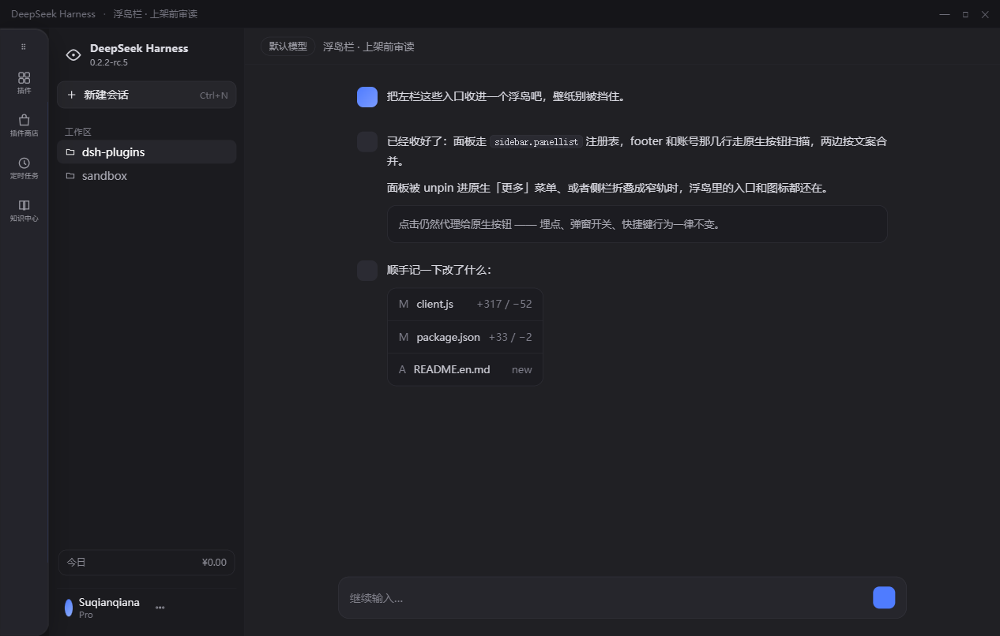
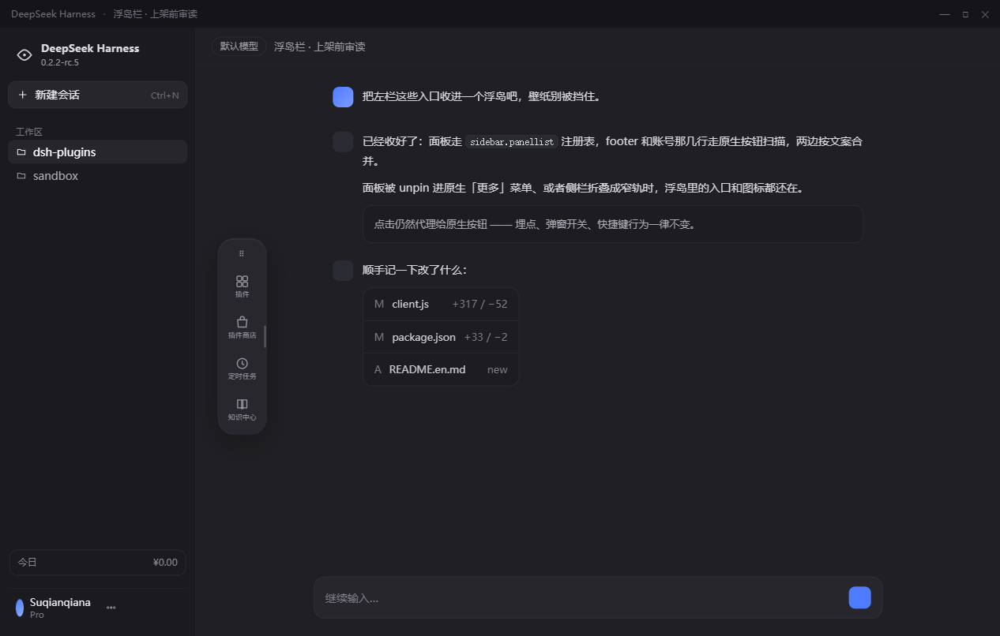

# 浮岛栏 Float Islands

把 DeepSeek Harness 左栏（sidebar）的全部入口收进一个可拖拽的玻璃浮岛。入口不丢、事件不搬、壁纸不被盖住。



<p align="center"><sub>吸附模式 · 原生入口已收起，浮岛在左栏外侧</sub></p>



<p align="center"><sub>浮岛模式 · 拖到任意位置，玻璃透出背景</sub></p>

- 适用：DSH 0.2.2-rc.5 及以后的 web 界面（桌面端与浏览器端同一套）
- 许可：MIT
- 网络：**不发起任何网络请求，不采集任何数据**

## 它解决什么

- 左栏越长越难找：面板、知识中心、工作区、账号、设置挤成一列，纵向空间被入口吃掉。
- 壁纸/皮肤主题下，左栏是最挡画面的一块。
- 插件装多了之后，入口还在长，浮岛还能一行摊开或收成竖条。

## 功能

- 🏝 **两种形态**：可拖动的自由浮岛，或吸附在左栏左侧的固定竖栏（dock），一键切换。
- 🧭 **全量入口**：面板来自 `sidebar.panellist` 注册表，footer、知识中心、工作区、账号、设置来自原生按钮扫描。面板被 unpin 进原生「更多」菜单、侧栏折叠成窄轨时，浮岛里仍然在。
- 🖱 **可拖动 + 可调列数**：抓 ⠿ 拖动；拖右侧边框从 1 列切到全部一行。
- 🎨 **壁纸共存**：半透明毛玻璃 + DSH 主题 token，检测到壁纸引擎/皮肤时自动换成更克制的玻璃层，绝不铺不透明画布。
- ⚙️ **设置页**：入口迁移（勾选哪些进浮岛）、是否隐藏原生入口、图标尺寸、列数、停靠位置、复位位置。
- 🌐 **中英双语**：跟随 DSH 语言设置。
- 🧩 **不抢事件**：点击仍代理给原生按钮，宿主的埋点、弹窗、快捷键行为不变。

## 安装

**方式一 · 插件管理器（推荐）**
在 DSH 的「插件」页安装本包，或在 Profile 里加入 bundles 列表。

**方式二 · 命令行（本地目录）**

```bash
dsh --profile web plugin add link:<本目录绝对路径>
```

**方式三 · 市场索引（最省事）**
设置 → 插件市场（Discover）→ 索引 → 添加这个地址，然后在列表里点安装：

```
https://cdn.jsdelivr.net/gh/Suqianqiana/dsh-float-islands@main/market/index.json
```

> 修改 `client.js` 后刷新页面即可；修改 `package.json` 里的 `dsh.client` 声明需要完全重启 DSH。

## 设置项

| 设置 | 默认 | 说明 |
| --- | --- | --- |
| 启用浮岛栏 | 开 | 关闭后恢复原生界面，浮岛不渲染 |
| 吸附到左侧栏 | 开 | 吸附后是固定竖栏；关掉变可拖动的浮岛 |
| 隐藏已迁移的原生入口 | **关**（新装）/ 沿用旧值 | 开启后，勾选的入口从原生侧栏消失；这是可选行为，不会默认替你改界面 |
| 毛玻璃效果 | 开 | 壁纸引擎启用时自动切到更轻的玻璃层 |
| 显示入口名称 | 开 | 关闭后只显示图标，hover 出名字 |
| 停靠位置 / 距边缘距离 | 左侧 / 268px | 浮岛初始贴哪边 |
| 图标尺寸 | 中 | 小 / 中 / 大 |
| 浮岛列数 | 1 | 1 列竖排，最大为全部一行 |
| 浮岛位置 | — | 拖动后的坐标；「复位位置」可拉回默认 |
| 入口迁移 | 除新会话/账号外全选 | 勾选进入浮岛的入口，改完点「保存入口迁移」 |

## 兼容性

- DSH 0.2.2-rc.5 实测；`engines.dsh` 声明为 `>=0.2.2-rc.5`。
- 面板通道依赖 `ctx.slots.entriesOfSlot` 与 `ctx.layout.selectPanel`；宿主缺任一接口时自动退化为纯 DOM 扫描，功能与 1.2.x 一致。
- 与壁纸引擎、皮肤中心、其他右栏类插件共存：只读侧栏 DOM，只在侧栏内部改可见性。

## 它是怎么做的

- **入口双通道**：`sidebar.panellist` 注册表给稳定 id/顺序/文案；DOM 扫描补图标与非面板入口。两者按文案合并，DOM 顺序优先。
- **点击优先走原生**：按钮还在就 `btn.click()`；行不存在（unpin / 窄轨 / 抽屉关闭）才回退 `layout.selectPanel(id)`，并保留"延后一拍"的时序，避免弹窗被同一次点击关掉。
- **扫描只盯侧栏**：MutationObserver 只观察 `[data-slot="sidebar"]` 子树，按帧合并 + 内容签名去重；侧栏暂时卸载时保留上次入口，不会把浮岛清空。
- 更细的踩坑记录见 [HANDOFF.md](HANDOFF.md)。

## 常见问题

**原生入口被我藏了，怎么恢复？**
设置 → 浮岛栏 → 关掉「隐藏已迁移的原生入口」，或直接关闭「启用浮岛栏」。

**浮岛拖出屏幕了怎么办？**
它会被限制在视口内（至少留 8px）；万一仍看不到，设置 → 浮岛栏 → 「复位位置」。

**把面板 unpin 进原生「更多」菜单后，浮岛里还有吗？**
有。浮岛走注册表，图标也按 id 缓存着。

**会不会拖慢界面？**
扫描只观察侧栏子树，内容不变就不通知 React；流式输出时不会再全量扫描。

## 开发

```bash
npm install
npm run check   # node --check 三个入口文件
npm test        # jsdom 回归套件（17 个用例）
```

测试用仿真宿主壳加载真实 `client.js` 渲染浮岛与设置页，覆盖入口扫描、注册表兜底、空扫描保护、偏好迁移与 i18n。

> 跑测试需要 Node 22.22+ 或 24.15+（jsdom 31 的要求）；插件本身在浏览器里运行，不依赖宿主 Node 版本。

## 许可

MIT © Suqianqiana
